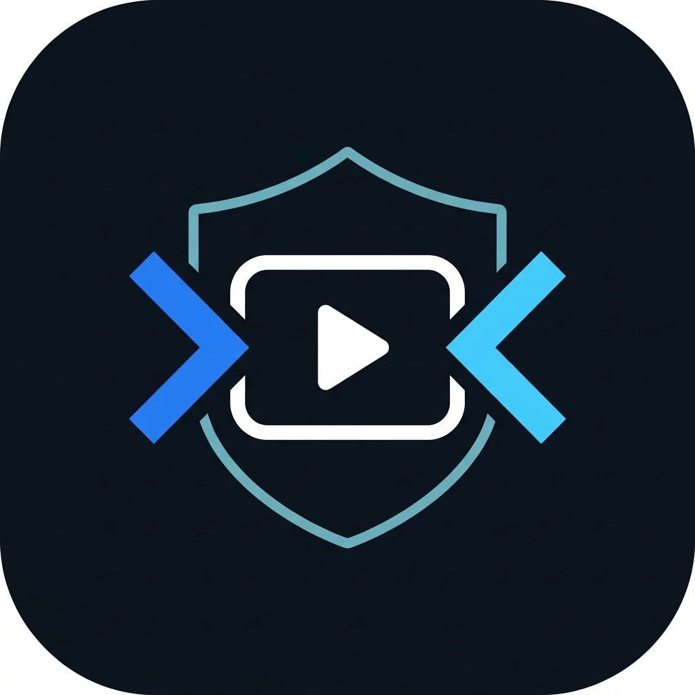

<div align="center">
  
  <h1>SlimVid · 片纖瘦</h1>
  <p>
    <strong>100% Client-Side, Zero-Upload Video Compressor</strong><br>
    <strong>100% 瀏覽器本地運算 · 零伺服器上傳影片壓縮器</strong>
  </p>
  <p>
    <a href="https://jackylawck.github.io/SlimVid/"><strong>🌐 Live Demo 線上使用</strong></a>
    ·
    <a href="./PRIVACY.md">Privacy & Non-AI 私隱聲明</a>
    ·
    <a href="./SECURITY.md">Security 資訊安全</a>
    ·
    <a href="./TERMS.md">Terms 使用條款</a>
  </p>
  <p>
    <a href="https://github.com/jackylawck/SlimVid/actions/workflows/ci-cd.yml">
      
    </a>
    <a href="./LICENSE">
      
    </a>
    
    
  </p>
</div>

---

## Overview | 專案簡介

**English:**  
**SlimVid** is a serverless, 100% browser-based video compressor engineered with a Zero-Trust security model. It compresses large mobile and desktop videos (including 4K Apple `.MOV` / HEVC recordings) directly on your device using hardware-accelerated **WebCodecs** with an automatic **FFmpeg.wasm** fallback—ensuring your media files never leave your device.

**繁體中文：**  
**「SlimVid · 片纖瘦」** 是一款採用零信任（Zero-Trust）安全架構設計的純前端無伺服器影片壓縮工具。您可直接在手機或電腦瀏覽器內，將數百 MB 的大型影片（包括 iPhone 4K `.MOV` / HEVC 影片）快速壓縮至指定體積；系統優先調用硬件加速 **WebCodecs**，並具備 **FFmpeg.wasm** 自動兜底機制，**全程本地運算、影片絕不上傳任何伺服器**。

---

## Key Features | 核心特色

* **100% Zero-Upload Privacy (`default-src 'none'`) | 技術鎖死零上傳私隱：**  
  Enforces a strict Content Security Policy at the top of `<head>` with self-hosted dependencies (`vendor/`), blocking unauthorized outbound network connections at the browser layer.  
  於 `<head>` 首行強制執行嚴格 CSP 政策並自託管所有依賴套件，由瀏覽器底層直接阻斷任何對外網絡連線。

* **Hardware-Accelerated WebCodecs Pipeline | 硬件加速流式轉碼管線：**  
  Runs in a Dedicated Web Worker with `4 MB` chunked MP4/MOV demuxing, Apple QuickTime `mp4a` / `wave` AAC extraction, automatic orientation baking, `60fps -> 30fps` frame decimation, and mobile 4K memory protection.  
  採用獨立 Worker 進行 `4 MB` 分塊流式拆包，完整支援 iPhone `.MOV` 音軌與旋轉矩陣校正、`60fps -> 30fps` 智慧抽幀，並針對手機 4K 記憶體設有動態佇列限流保護。

* **Smart Target Size Slider & Presets | 動態滑桿與快捷目標大小：**  
  Features an adaptive range slider that automatically scales to your selected video's size, paired with one-tap size chips (`20 MB`, `25 MB`, `50 MB`, `100 MB`), custom MB input, and quality presets (`High`, `Balanced`, `Compact`).  
  內建隨影片大小自動調整上下限的觸控滑桿，配合一鍵大小按鈕（`20 MB` / `25 MB` / `50 MB` / `100 MB`）、自訂小數 MB 輸入及三段畫質模式。

* **Automatic FFmpeg.wasm Fallback & Memory Wipe | 自動軟件兜底與高私隱記憶體清理：**  
  Seamlessly falls back to single-threaded `FFmpeg.wasm` (`WORKERFS` zero-copy mount) for legacy browsers or non-AAC codecs, with an optional High-Privacy Mode that terminates the Worker to wipe WebAssembly memory immediately after completion.  
  當瀏覽器或編碼格式不支援 WebCodecs 時自動切換至單線程 `FFmpeg.wasm`（零複製掛載）；開啟「高私隱記憶體清理模式」後，完成即強制銷毀 Worker 清空記憶體。

* **Bilingual UI & PWA Support | 中英雙語與手機加入主畫面：**  
  Instant switching between Traditional Chinese (`繁中`) and English (`EN`) without HTML injection sinks, plus full Web App Manifest support for adding to iOS / Android home screens.  
  支援一鍵切換「繁中 / EN」（零 `innerHTML` 注入風險），並支援手機瀏覽器「加入主畫面」作獨立應用程式使用。

---

## Live Usage | 線上使用方式

1. Open **[https://jackylawck.github.io/SlimVid/](https://jackylawck.github.io/SlimVid/)** in Chrome, Edge, or Safari (iOS 16.4+ / macOS / Windows / Android).  
   使用 Chrome、Edge 或 Safari 開啟 **[https://jackylawck.github.io/SlimVid/](https://jackylawck.github.io/SlimVid/)**。
2. Select or drag & drop a video file (`.mov`, `.mp4`, `.webm`, `.mkv`).  
   點選或拖放影片檔案（支援 iPhone `.MOV`、`.MP4`、`.WebM`、`.MKV`）。
3. Choose a preset or drag the slider / enter your desired target size in MB, then click **Compress Video (開始壓縮)**.  
   選擇壓縮模式，或拖動滑桿／輸入目標 MB 數，按 **「開始壓縮」** 即可在本機完成並下載。

> **iPhone Tip | iPhone 使用貼士：**  
> For large recordings (hundreds of MB), saving the video to the **Files (檔案)** app first avoids iOS Photos pre-conversion delays and speeds up loading.  
> 壓縮數百 MB 大型影片時，建議先將影片儲存至「檔案 (Files)」App 再選取，可避開相簿系統預轉檔並加快載入速度。

---

## Project Structure | 專案架構

```text
SlimVid/
├── index.html                      # Strict CSP, SEO/OG metadata, PWA & bilingual UI shell
├── styles.css                      # Responsive light/dark theme & touch-friendly controls
├── manifest.webmanifest            # PWA manifest for mobile home-screen installation
├── SlimVid192icon.png              # 192x192 minimalist app icon
├── SlimVid512icon.png              # 512x512 high-detail app & Open Graph icon
├── package.json                    # Pinned devDependencies & verification scripts
├── src/
│   ├── paths.js                    # Same-origin self-hosted vendor URL resolver
│   ├── core/
│   │   ├── capabilities.js         # Hardware codec & platform capability detector
│   │   ├── orchestrator.js         # Engine router (WebCodecs Worker -> FFmpeg fallback)
│   │   ├── planner.js              # Pure deterministic bitrate, resolution & risk planner
│   │   └── protocol.js             # Hardened Main <-> Worker message & stream bridge
│   ├── engines/
│   │   ├── mp4-scanner.js          # Top-level MP4/MOV box scanner & QuickTime AAC parser
│   │   ├── webcodecs.worker.js     # Dedicated WebCodecs hardware transcoding Worker
│   │   └── ffmpeg.engine.js        # Single-threaded FFmpeg.wasm WORKERFS fallback engine
│   └── ui/
│       ├── app.js                  # XSS-safe DOM controller, slider sync & Wake Lock
│       └── i18n.js                 # Traditional Chinese (zh-HK) & English dictionary
├── scripts/
│   ├── vendor-sync.mjs             # Bundles pinned dependencies into self-hosted vendor/
│   ├── vendor-checksum.mjs         # Generates & verifies SHA-256 supply-chain hashes
│   └── syntax-check.mjs            # ES module syntax verification across src/ & scripts/
├── tests/
│   ├── capabilities.test.mjs       # Platform detection & codec probe tests
│   ├── i18n.test.mjs               # Bilingual key parity & zero-HTML XSS guard tests
│   ├── mp4-scanner.test.mjs        # Apple QuickTime .MOV / wave / esds AAC parser tests
│   ├── planner.test.mjs            # Bitrate, rotation, level & device risk tests
│   └── protocol.test.mjs           # Worker IPC, backpressure & stream abort tests
├── .github/workflows/ci-cd.yml     # Automated security gates, unit tests & Pages CD
├── PRIVACY.md                      # Zero-upload privacy & Non-AI deterministic declaration
├── SECURITY.md                     # CSP, supply-chain integrity & ISO 27001/27701 alignment
├── TERMS.md                        # Terms of use, disclaimers & open-source notices
└── LICENSE                         # MIT License

```

---

## Governance, Privacy & Security | 合規、私隱與資訊安全

* **[Privacy Policy & Non-AI Declaration (`PRIVACY.md`)](https://www.google.com/search?q=./PRIVACY.md)**
Details our zero-upload data architecture, compliance with Hong Kong PDPO (Cap. 486), EU GDPR, and China PIPL, as well as an explicit declaration that SlimVid uses deterministic math and standard codecs with **zero AI/ML components** (exempt from EU AI Act and ISO/IEC 42001).
詳述零上傳資料架構、香港《個人資料（私隱）條例》(Cap. 486)、歐盟 GDPR 及中國 PIPL 合規性，並明確聲明本項目僅採用確定性數學運算與標準編解碼器，**不含任何 AI／機器學習組件**。
* **[Security Policy & Controls (`SECURITY.md`)](https://www.google.com/search?q=./SECURITY.md)**
Documents CSP `default-src 'none'` enforcement, `Permissions-Policy` hardware isolation, SHA-256 vendor verification, DOM XSS prevention, and technical alignment with ISO/IEC 27001 & 27701 principles.
說明 `default-src 'none'` 內容安全政策、硬件權限隔離、SHA-256 依賴校驗、DOM XSS 防護及與 ISO/IEC 27001 / 27701 原則之技術控制對齊。
* **[Terms of Use & Third-Party Notices (`TERMS.md`)](https://www.google.com/search?q=./TERMS.md)**
Covers user verification responsibilities, warranty disclaimers, limitation of liability, and attributions for `mp4box.js`, `mp4-muxer`, and `ffmpeg.wasm`.
列明用戶自行核實檔案之責任、無擔保與責任限制條款，以及第三方開源組件授權聲明。

---

## Local Development & CI Verification | 本機開發與測試

```bash
# 1. Install exact pinned devDependencies | 安裝鎖定版本開發依賴
npm install

# 2. Bundle self-hosted vendor files & generate SHA-256 checksums | 打包自託管依賴並生成雜湊校驗
npm run vendor:sync

# 3. Verify vendor SHA-256 integrity & ES module syntax | 驗證依賴完整性與模組語法
npm run vendor:verify
npm run syntax:check

# 4. Run all unit tests | 執行全部單元測試
npm test

```

Serve the root directory using any local static HTTP server (for example, `npx serve .` or `python3 -m http.server 8080`) and visit `http://localhost:8080`.

使用任何本機靜態伺服器（如 `npx serve .` 或 `python3 -m http.server 8080`）啟動根目錄，並開啟 `http://localhost:8080` 即可進行開發測試。

---

## License | 開源授權

Licensed under the **[MIT License](https://www.google.com/search?q=./LICENSE)** 

```

```
